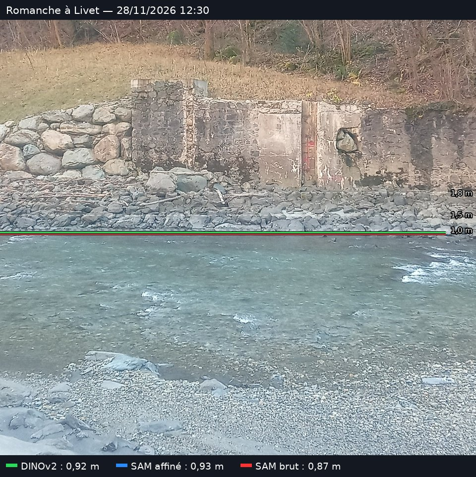

# Niveau de la Romanche par vision

Mesurer le niveau de la Romanche à Livet (Isère) à partir des photos d'une caméra fixe, prises toutes les
15 minutes. Projet du cours INF8422 – Perception robotique (Polytechnique Montréal), automne 2026.

## En direct

<p align="center">
  
</p>

- **trait vert** : DINOv2
- **trait bleu** : SAM affiné
- **trait rouge** : SAM sans entraînement
- **pointillés blancs** : repères 1,0 / 1,5 / 1,8 m

Mise à jour toutes les 15 min · [relancer / réactiver](https://github.com/MathisBorie/vision_romanche_level/actions/workflows/niveau_live.yml) · [historique](https://github.com/MathisBorie/vision_romanche_level/blob/live/historique.csv)

## Trois modèles disponibles

Nous mettons à disposition trois modèles, avec leurs poids, dans [`niveau_eau/`](niveau_eau/) :

```python
from niveau_eau import mesurer_niveau
mesurer_niveau("photo.jpg", methode=3, en_metres=True)   # 1 = SAM brut, 2 = SAM affiné, 3 = DINOv2
```

Nous en gardons trois parce qu'ils ne vieilliront pas de la même façon. DINOv2 et SAM affiné ont appris sur
nos photos de mai à novembre : si la berge change (végétation, enrochement déplacé par une crue, neige), ils
peuvent se dérégler. **SAM sans entraînement est le moins précis sur le papier, mais sans doute le plus
stable dans le temps** : il ne connaît pas nos photos, il se contente de séparer l'eau du reste, ce qui ne
dépend pas de l'aspect de la berge.

## Résultats

Erreur sur 883 photos de 3 semaines jamais vues à l'entraînement (juin, septembre, octobre), en pixels.
Vers 1 m d'eau, 1 px ≈ 1 cm.

| Famille | Méthode | Erreur moyenne | Médiane | Pire cas | À 10 px près |
|---|---|---|---|---|---|
| Sans apprentissage | Lignes de pixels (texture) | 20,6 | 9,0 | 255 | 58 % |
| Études mathématiques | PLS + réseau | 10,7 | 9,3 | 105 | 53 % |
| | POD + réseau | 10,5 | 8,8 | 121 | 55 % |
| Apprentissage | CNN entraîné de zéro | 7,7 | 6,5 | 30 | 68 % |
| | **SAM sans entraînement** | 8,9 | 7,0 | 574 | 71 % |
| | **SAM affiné** | 6,5 | 6,0 | 28 | 78 % |
| | ResNet-50 affiné | 6,3 | 5,3 | 23 | 78 % |
| | **DINOv2 gelé + tête** | **5,9** | **5,2** | **23** | **83 %** |
| Référence | toujours le niveau moyen | 47,4 | | | |

## Organisation

| Dossier | Contenu |
|---|---|
| [`niveau_eau/`](niveau_eau/) | les 3 modèles prêts à l'emploi (poids dans la [Release](https://github.com/MathisBorie/vision_romanche_level/releases/tag/modeles-v1)) |
| [`etudes/`](etudes/) | approches mathématiques : POD, Fourier, PLS, produits scalaires, lignes de pixels, statistiques d'erreur |
| [`apprentissage/`](apprentissage/) | réseaux entraînés : encodeurs (DINOv2, ConvNeXt, ResNet), SAM, CNN, comparaison de toutes les méthodes |
| [`donnees/`](donnees/) | photos, annotation manuelle du niveau, découpage train / test |
| [`rapport/`](rapport/) | rapport et diapositives |

Mathis Borie, Aymen Bouakkaz, Tristan Lymburner.
